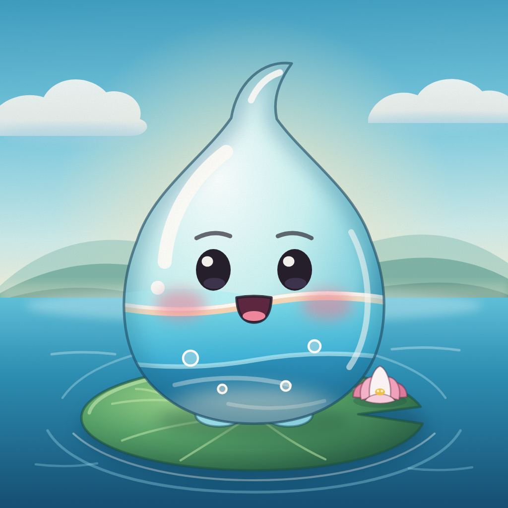
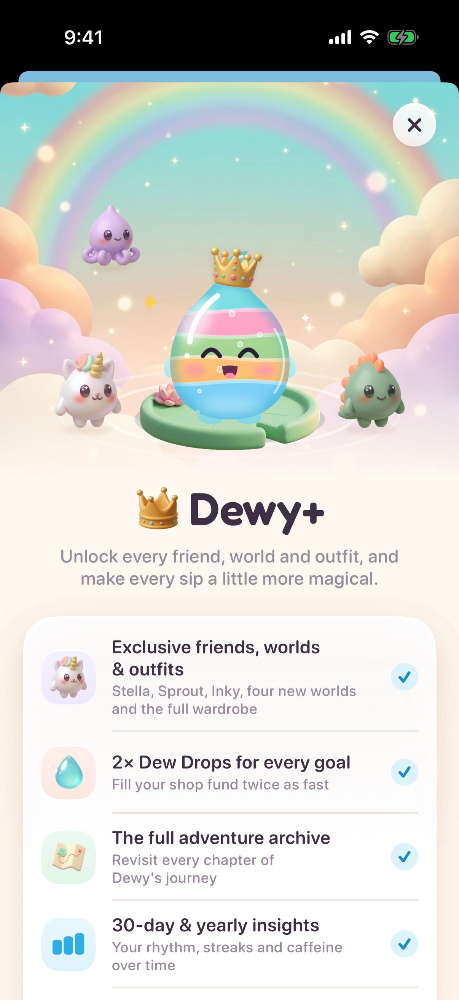
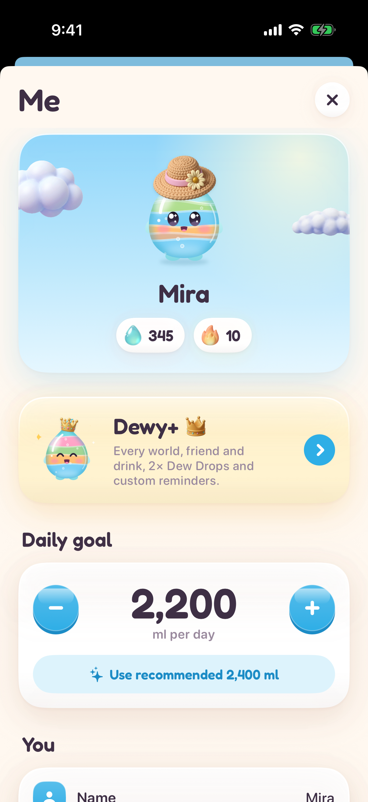
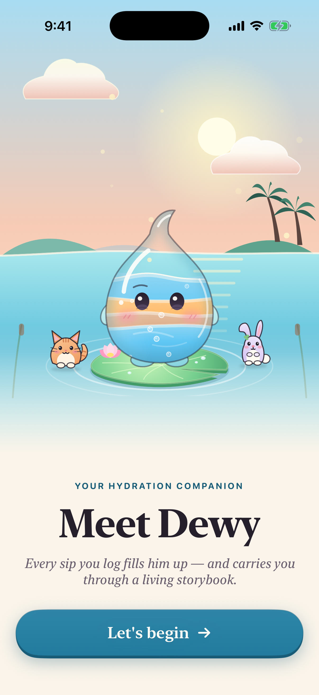
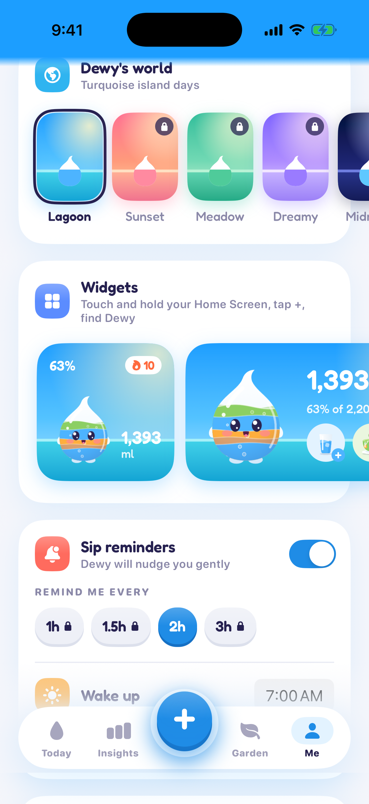
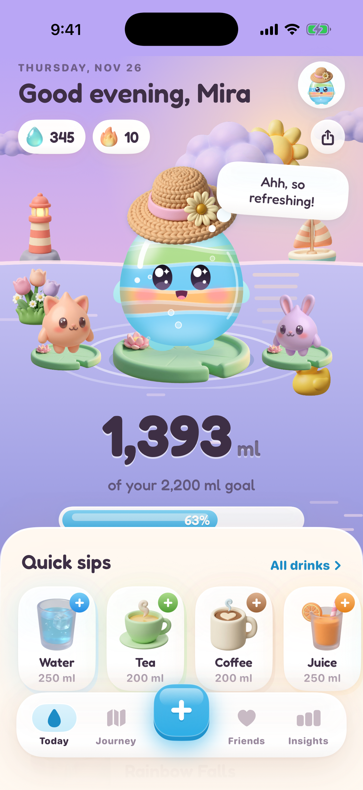
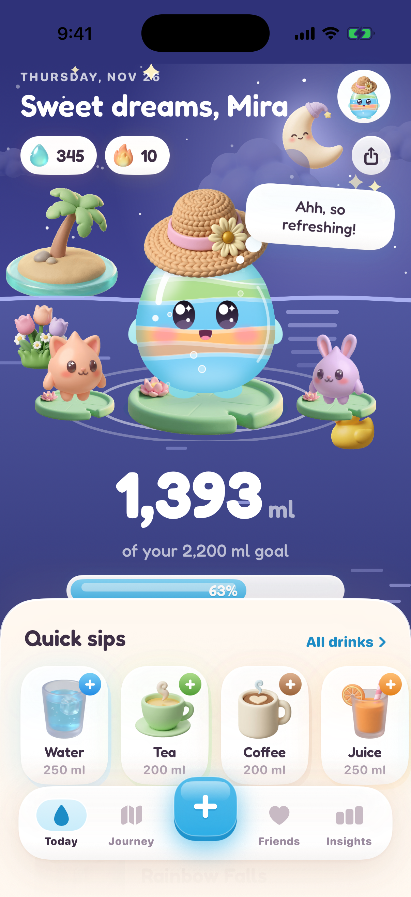

<div align="center">



# Dewy — cute clay water tracker

**A translucent jelly droplet who lives in a soft 3D clay world and fills up, layer by pastel layer, with every sip.**
Tilt your phone to slosh the water inside Dewy, travel to a new illustrated world on every goal day, collect 12 clay friends, dress Dewy in 14 outfits, decorate the pond, sync with Apple Health and log straight from the Dynamic Island.

SwiftUI · iOS 17+ · Swift Charts · HealthKit · ActivityKit · CoreMotion · StoreKit 2 · no third-party dependencies

[](https://github.com/baabi-boo/IOS-APP1/actions/workflows/ios.yml)


</div>

---

## Screenshots

<p align="center">
  
  
  
</p>
<p align="center">
  
  
  
</p>
<p align="center">
  
  
  
</p>
<p align="center">
  
  
  
</p>

<details>
<summary><b>More worlds, skies &amp; challenges</b> (Dusk · Starlight Night · Worlds · Challenges)</summary>
<p align="center">
  
  
  
</p>
<p align="center">
  
</p>
</details>

> Every screenshot above is a real iOS Simulator capture, taken by CI on each push (`.github/workflows/ios.yml` → `scripts/screenshots.sh`). The GIF comes from the simulator recording in `docs/raw/`. CI simulators render on the CPU, so the GIF plays less smoothly than the app does on a real iPhone.

---

## Visual language

Dewy is designed as a cohesive **soft 3D clay toybox** rather than a flat utility tracker. Every surface, character and animation follows the same physical rules:

| | Rule | In the app |
| --- | --- | --- |
| 🫧 | **Soft 3D clay surfaces.** Every card, pill and sheet uses the same `ClaySurface` recipe: a bright top inner highlight rim, warm subtle bottom shade, and a soft tinted drop shadow. | Warm cream canvas (`#FFF8F0`), deep plum-brown ink (`#3E2F45`), white clay cards, and tinted glows matching each drink, friend or chapter. |
| 🍬 | **Puffy candy buttons.** Interactive CTAs sit on a darker 3D lip with a top gloss pill and squash down onto the lip when pressed. | `PrimaryButton`, `ChipButton`, `ClaySegmented`, and the raised aqua `+` in the floating tab bar. |
| 💧 | **Code-drawn jelly hero, illustrated clay cast.** Dewy, the layered liquid, waves, bubbles, limbs and sparkles are drawn in SwiftUI `Canvas` for 60 Hz physics; the cast, drinks, outfits, props and worlds are custom clay illustrations. | Dewy tilts and sloshes with `CoreMotion` spring physics, stacks drink-colored layers like a parfait, and wears hats, glasses and scarves over the live canvas. |
| 🌤 | **Living worlds & real-time skies.** Worlds are places with 3D landmarks, parallax clay clouds, interactive tap-to-ripple ponds, and skies that follow the real time of day. | Dawn, Day, Dusk and Night palettes across Lagoon, Seaside, Meadow, Cloudland and Starlight. |
| 🔤 | **Two rounded voices.** Fredoka for headlines, big numbers and buttons; SF Pro Rounded for body copy and labels. | Warm, friendly letterforms with generous spacing and zero harsh black borders. |
| ✨ | **Tactile feedback everywhere.** Springs, flying pour-in arcs, splash bursts, clay confetti, synthesized bloops/chimes and matched haptics — all respecting Reduce Motion. | Every sip arcs from its tile into Dewy, splashes on the lily pad, pops a `+Dew Drops` badge and animates the liquid level. |

---

## Features

- 💧 **Dewy, a living jelly mascot.** Fills with a pastel layer for every drink, with rolling waves, rising bubbles and **tilt-slosh** (`CoreMotion` damped spring physics when you tilt or shake your phone). Four moods (`thirsty` → `okay` → `happy` → `ecstatic`), blinking, breathing, squash-and-stretch hops and a wave when poked.
- 🗺 **Daily Journey (8 illustrated chapters).** Every day you hit your goal, Dewy travels to a new clay world — Misty Spring, Bubble Brook, Lily Meadow, Rainbow Falls, Coral Cove, Cloud Peak, Lantern Grove and Starlight Lake — unlocking 4 story moments at 25%, 50%, 75% and 100%, with a trail map and adventure archive.
- 🐾 **Dewy & Friends (12 collectible characters).** Adopt Mochi, Lulu, Pip, Coral, Honey, Pebble, Clem, Sunny, Bao, Stella, Sprout and Inky using Dew Drops, and invite up to two companions to bob on lily pads beside Dewy.
- 👒 **Wardrobe (14 outfits) & Pond Decor (10 items).** Dress Dewy in hats, glasses and neckwear (Cozy Beanie, Sun Hat, Royal Crown, Flower Crown, Heart Shades, Knit Scarf, Lo-fi Phones, Wizard Hat…) and place tulips, a rubber duck, lanterns, a swan float, blossom tree or rainbow around the pond.
- 💎 **Dew Drops (earned, never sold).** Earn drops from sips, story moments, daily goals, streaks, challenges and badges — spend them in the Friends, Wardrobe and Decor shelves.
- 🍵 **12 clay drinks** with hydration factors, caffeine and sugar: water, sparkling, tea, coffee, juice, milk, smoothie, soda, lemonade, hot cocoa, coconut water and matcha.
- 🏆 **Challenges & Badges.** Six week-long quests (Morning Glass, Perfect Week, Soda Detox, Caffeine Cut, Tea Ritual, Taste Rainbow) that award exclusive outfits + drops, plus 9 clay achievement medals.
- 📈 **Insights.** Weekly Dewy droplet strip, 7-day / 30-day / yearly Swift Charts bar trends with interactive scrubbing, streak calendar with joined pastel run capsules, drink-mix donut, hourly sip rhythm and caffeine budget tracker.
- ❤️ **Apple Health sync.** Writes logged drinks as Dietary Water (tagged for clean undo deletion) and reads body weight to tune your recommended daily goal.
- 📱 **Live Activity, Dynamic Island & Widgets.** Track today's progress on the Lock Screen and Dynamic Island with one-tap `+150` / `+250` / `+500` quick-sip buttons, plus Home Screen and Lock Screen widgets and Siri/Shortcuts support.
- 📤 **Share your day.** Export a crisp 3× clay postcard showing Dewy in your world, today's drinks, total, streak and drops earned.
- 🧭 **Personalized onboarding & gentle reminders.** Weight, activity, climate and wake/sleep schedule calculate your goal; optional reminders nudge you between wake-up and bedtime.
- ♿️ **Accessible & private.** VoiceOver labels across controls and charts, Reduce Motion support, and local-only JSON storage with backward-compatible decoding.

---

## Monetization (Dewy+)

StoreKit 2, implemented in [`PurchaseManager.swift`](Dewy/Store/PurchaseManager.swift):

| Product ID | Type | Price |
| --- | --- | --- |
| `dewy.plus.yearly` | Auto-renewable, 3-day free trial | $19.99 / year |
| `dewy.plus.monthly` | Auto-renewable | $2.99 / month |
| `dewy.plus.lifetime` | Non-consumable | $39.99 |

- **Free:** core tracking, Lagoon world, water/tea/coffee/juice, 7-day insights, daily Journey + 7-day archive, challenges, badges, core friends/outfits/decor, Live Activity and Apple Health water sync.
- **Dewy+:** exclusive friends (Stella, Sprout, Inky), 4 more worlds (Seaside, Meadow, Cloudland, Starlight), 8 more drinks, premium outfits & decor, **2× Dew Drops** on daily goals, full adventure archive, 30-day & yearly insights, Apple Health history and custom reminder intervals.

`Dewy.storekit` is wired into the shared scheme so purchases work in the simulator without App Store Connect setup.

---

## Project structure

```
Dewy/
├── App/DewyApp.swift            # entry point, AppRouter, floating clay tab bar, Health & Live Activity hooks
├── Design/                      # Theme (SkyPhase, AppTheme, Palette, Ink, Fredoka), Modifiers (ClaySurface, CandyButtonStyle), SoundFX
├── Components/                  # MascotView (jelly Dewy + tilt-slosh + outfits), Scene (ClayWorld, LilyPad), Effects, Shapes
├── Models/Models.swift          # DrinkKind, UserProfile, Friend, Outfit, Decor, Chapter, CollectionState, Challenges, Achievements
├── Store/                       # HydrationStore, Economy (Dew Drops, shop, Journey), HealthSync, LiveActivityManager, MotionManager, PurchaseManager, ReminderScheduler, DemoData
├── Features/                    # TodayView, JourneyView, FriendsView, InsightsView, DrinkPickerSheet, SettingsView (Me), PaywallView, OnboardingView, ShareCardView
├── Widgets/                     # WidgetViews, LogDrinkIntent, LiveActivity (shared with DewyWidgetExtension)
└── Resources/                   # Fredoka fonts (OFL) and synthesized sound effects
DewyWidget/                      # WidgetKit extension (Home Screen, Lock Screen & Live Activity / Dynamic Island)
Config/                          # App & Widget entitlements (App Group + HealthKit)
scripts/
├── screenshots.sh               # builds for iOS Simulator and captures all 16 screenshots + celebrate.mp4
├── make-gif.sh                  # converts docs/raw/celebrate.mp4 into docs/demo.gif
└── clay-art.py                  # transparent-background & pngquant asset catalog pipeline
```

---

## Build & run

1. Open `Dewy.xcodeproj` in **Xcode 16 or later**.
2. Under *Signing & Capabilities* for both targets, select your team and update the bundle IDs (`com.dewyapp.Dewy`, `com.dewyapp.Dewy.Widget`) and App Group (`group.com.dewyapp.Dewy` in `Config/*.entitlements` and `Persistence.appGroup`).
3. Ensure **HealthKit** and **Push Notifications / Live Activities** (`NSSupportsLiveActivities = YES`) capabilities are enabled for the app target.
4. Run on an iPhone or simulator running **iOS 17+**.

**Demo mode.** Launch with `-screenshot today|add|journey|friends|wardrobe|places|insights|challenges|badges|share|me|widgets|paywall|onboarding|celebrate` to load sample data. Optional flags: `-theme lagoon|peach|matcha|lavender|midnight`, `-phase dawn|day|dusk|night`, `-premium YES`, `-step 0…5`. Run `bash scripts/screenshots.sh` on macOS to regenerate every screenshot.

## Credits

Display type: [Fredoka](https://github.com/google/fonts/tree/main/ofl/fredoka) by Milena Brandão, SIL Open Font License (see `design/Fredoka-OFL.txt`). All illustrations, the mascot and sounds are original to this project.
