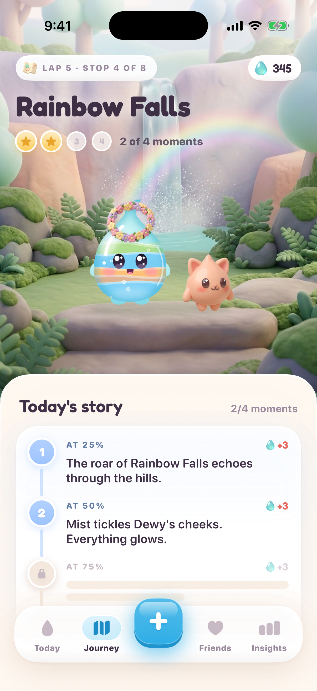
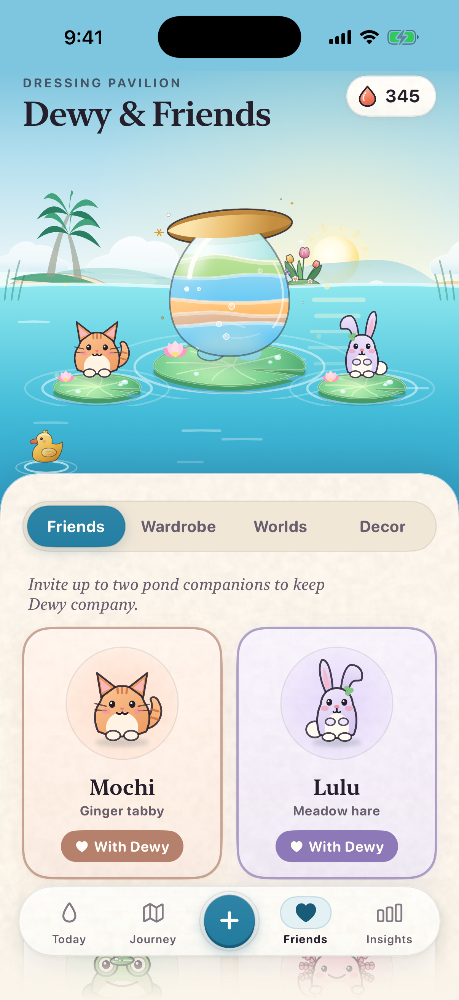
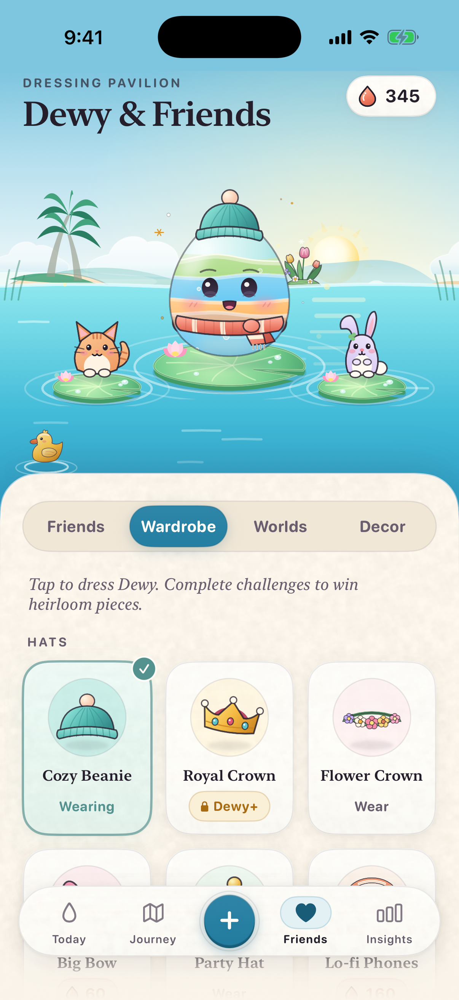
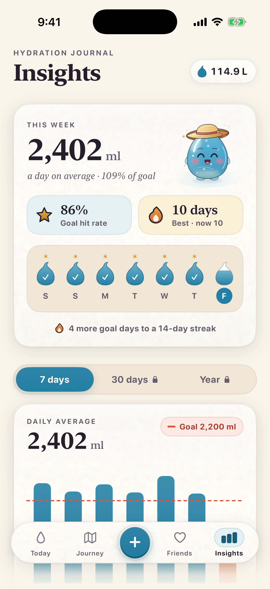
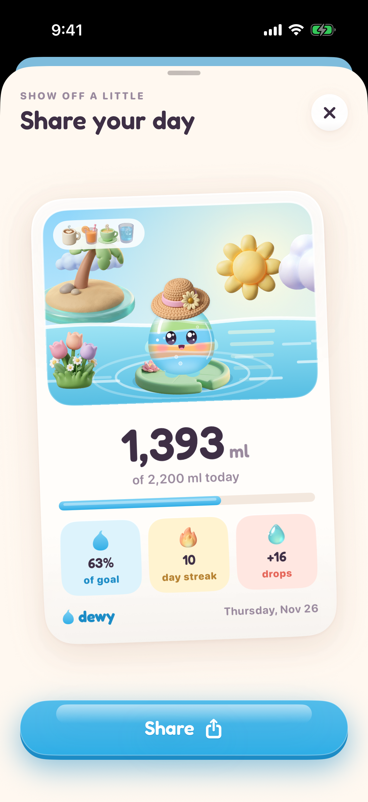
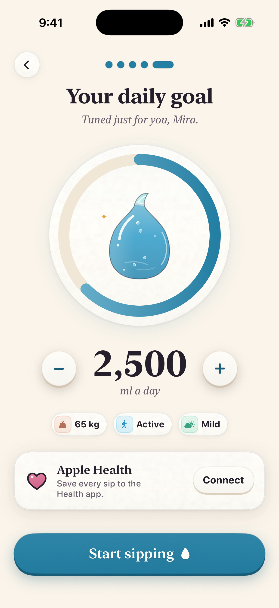
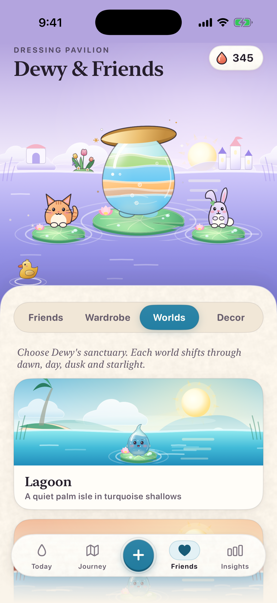
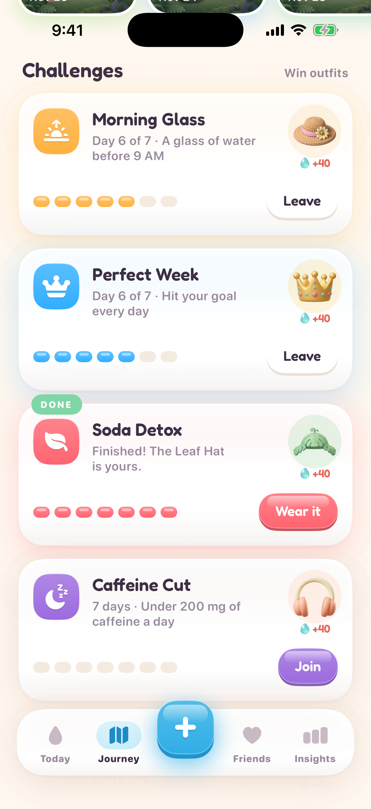

<div align="center">


# Dewy — storybook gouache water tracker

**A handcrafted porcelain-glass water spirit living in a sunlit gouache & paper-cut sanctuary, filling up layer by watercolor layer with every sip.**
Tilt your phone to slosh the water inside Dewy, travel to a new live-animated storybook chapter on every goal day, collect 12 animated pond companions, dress Dewy in 14 layered outfits, decorate the shore, sync with Apple Health and log straight from the Dynamic Island.

SwiftUI · Metal Shaders · iOS 17+ · Swift Charts · HealthKit · ActivityKit · CoreMotion · StoreKit 2 · zero third-party dependencies

[](https://github.com/baabi-boo/IOS-APP1/actions/workflows/ios.yml)


</div>

---

## Screenshots

<p align="center">
  
  
  
</p>
<p align="center">
  
  
  
</p>
<p align="center">
  
  
  
</p>
<p align="center">
  
  
  
</p>

<details>
<summary><b>More worlds, skies &amp; challenges</b> (Dusk · Starlight Night · Worlds · Challenges)</summary>
<p align="center">
  
  
  
</p>
<p align="center">
  
</p>
</details>

> Every screenshot above is a real iOS Simulator capture, taken by CI on each push (`.github/workflows/ios.yml` → `scripts/screenshots.sh`). The GIF comes from the simulator recording in `docs/raw/`. CI simulators render on the CPU, so the GIF plays less smoothly than the app does on a real iPhone.

---

## Visual language

Dewy is crafted as a cohesive **handcrafted storybook gouache & paper-cut sanctuary** (*Monument Valley × Studio Ghibli × Alto's Odyssey* meets tactile editorial stationery) with **zero AI-generated imagery** and **zero third-party libraries**:

| | Rule | In the app |
| --- | --- | --- |
| 📜 | **300gsm cotton rag paper surfaces.** Every card, pill, sheet and dock rests on `PaperSurface`: warm unbleached cotton (`#FAF4EA` / `#FFFDF8`), subtle Metal cold-press `.paperGrain`, delicate plum-espresso ink hairline (`#251E2B`), and tight archival contact shadows. | `PaperSurface`, `CanvasSheet`, `FloatingTabBar`, `CountPill`, and the collectible stationery `ShareDayCard` with letterpress inner frame and botanical postmark. |
| 🖋 | **Matte letterpress gouache stamps.** Interactive CTAs use hand-mixed gouache pigment faces with a fine paper bevel and solid compressed lip — zero plastic glare bars. | `StampButtonStyle`, `PrimaryButton`, `StorySegmented`, `ChipButton`, matte `ClayProgressBar`, and the nested circular cerulean `+` dock stamp. |
| 💧 | **100% native rigged Canvas cast & 42 bespoke SVGs.** Dewy, 14 two-layer rigged outfits (`OutfitArtView`), and all 12 animated storybook pond companions (`FriendView`) are drawn natively in SwiftUI `Canvas` at 60 Hz; all 12 drinks, 9 cloisonné badges, 10 shore keepsakes, 10 glyphs and the App Icon are bespoke hand-coded gouache SVGs. | Dewy sloshes with `CoreMotion` damped springs, shimmers with a Metal `.liveMeniscusGlow` shader, gulps with effervescent fizz on every sip, and shares the pond with paired, phase-staggered friends. |
| 🌤 | **5 living paper-cut worlds & 8 animated Journey panoramas.** Multi-plane gouache landscapes with Metal `.pondCaustics` and `.gouacheBloom`, real-time 4-phase skies, interactive tap-to-ripple water, and automatic status-bar harmony. | Lagoon, Seaside, Meadow, Cloudland and Starlight across Dawn, Day, Dusk and Night; 8 animated `JourneySceneView` chapters plus live `OnboardingPanoramaView` and `PaywallPanoramaView`. |
| 🔤 | **Editorial storybook typography.** Expressive Apple **New York `.serif`** (with italic poetic moments) for titles, chapter headers, greetings and sculpted numerals, paired with tabular **SF Pro Rounded** for compact UI labels and pills. | Crisp WCAG AA+ legibility across sunlit cotton paper, dusk violet harbors, and starlit indigo skies. |
| ✨ | **Pixar-grade kinetic follow-through.** Organic staggered choreography — `GouachePourStream` → `WatercolorSplashBurst` + Dewy gulp (`0.00s`) → recoil & lily-pad ripple (`0.04s`) → companion cheer hop (`0.12s`) → `+N drops` float (`0.18s`) — with matched haptics, synthesized audio and full Reduce Motion support. | Every sip feels alive without ever blocking input or cluttering the sanctuary. |

---

## Features

- 💧 **Dewy, a living porcelain-glass water spirit.** Fills with layered gouache bands for every drink, with rolling waves, rising fizz bubbles, Metal meniscus shimmer, **tilt-slosh** (`CoreMotion` damped spring physics), four expressive moods (`thirsty` → `okay` → `happy` → `ecstatic`), blinking, breathing, squash-and-stretch recoil and a blissful gulp on every sip.
- 🗺 **Daily Journey (8 live animated chapters).** Every day you hit your goal, Dewy travels to a new living panorama — Misty Spring, Bubble Brook, Lily Meadow, Rainbow Falls, Coral Cove, Cloud Peak, Lantern Grove and Starlight Lake — unlocking 4 italic journal beats at 25%, 50%, 75% and 100%, with a medallion trail map and postcard archive.
- 🐾 **Dewy & Friends (12 animated storybook companions).** Adopt Mochi, Lulu, Pip, Coral, Honey, Pebble, Clem, Sunny, Bao, Stella, Sprout and Inky using earned Dew Drops, and invite up to two live companions to breathe, blink and hop joyfully beside Dewy on miniature botanical lily pads.
- 👒 **Wardrobe (14 layered outfits) & Pond Decor (10 keepsakes).** Dress Dewy in hats, glasses and neckwear (Cozy Beanie, Sun Hat, Royal Crown, Flower Crown, Heart Shades, Knit Scarf, Lo-fi Phones, Wizard Hat…) and arrange tulips, a rubber duck, paper lanterns, a swan float, blossom tree or rainbow around the sanctuary.
- 💎 **Dew Drops (earned, never sold).** Earn sunlit coral drops from sips, story moments, daily goals, streaks, challenges and badges — spend them in the Friends, Wardrobe and Decor atelier.
- 🍵 **12 handcrafted gouache drinks** with hydration factors, caffeine and tasting notes: water, sparkling, tea, coffee, juice, milk, smoothie, soda, lemonade, hot cocoa, coconut water and matcha.
- 🏆 **Challenges & Badges.** Six week-long quests (Morning Glass, Perfect Week, Soda Detox, Caffeine Cut, Tea Ritual, Taste Rainbow) awarding heirloom outfits + drops, plus 9 antique-brass cloisonné achievement badges.
- 📈 **Insights.** Weekly Dewy droplet strip with antique-gold starlet crowns, 7-day / 30-day / yearly Swift Charts trends with 50% & 100% rules and interactive scrub callout, gouache streak calendar, drink-mix donut, hourly sip rhythm and caffeine budget tracker.
- ❤️ **Apple Health sync.** Writes logged drinks as Dietary Water (tagged for clean undo deletion) and reads body weight to tune your recommended daily goal.
- 📱 **Live Activity, Dynamic Island & Widgets.** Track today's progress on the Lock Screen and Dynamic Island with one-tap `+150` / `+250` / `+500` quick-sip buttons, plus per-world Home Screen and Lock Screen widgets and Siri/Shortcuts support.
- 📤 **Share your day.** Export a crisp 3× collectible cotton-rag stationery postcard showing Dewy & companion in your world, today's drinks, total, streak, drops earned and a hand-inked botanical postmark.
- 🧭 **Personalized onboarding & gentle reminders.** Weight, activity, climate and wake/sleep schedule calculate your goal; optional reminders nudge you between wake-up and bedtime.
- ♿️ **Accessible & private.** VoiceOver labels across controls and charts, full Reduce Motion support, and local-only JSON storage with backward-compatible decoding.

---

## Monetization (Dewy+)

StoreKit 2, implemented in [`PurchaseManager.swift`](Dewy/Store/PurchaseManager.swift):

| Product ID | Type | Price |
| --- | --- | --- |
| `dewy.plus.yearly` | Auto-renewable, 3-day free trial | $19.99 / year |
| `dewy.plus.monthly` | Auto-renewable | $2.99 / month |
| `dewy.plus.lifetime` | Non-consumable | $39.99 |

- **Free:** core tracking, Lagoon world, water/tea/coffee/juice, 7-day insights, daily Journey + 7-day archive, challenges, badges, core friends/outfits/decor, Live Activity and Apple Health water sync.
- **Dewy+:** exclusive friends (Stella, Sprout, Inky), 4 more worlds (Seaside, Meadow, Cloudland, Starlight), 8 more drinks, premium outfits & decor, **2× Dew Drops** on daily goals, full adventure archive, 30-day & yearly insights, Apple Health history and custom reminder intervals.

`Dewy.storekit` is wired into the shared scheme so purchases work in the simulator without App Store Connect setup.

---

## Project structure

```
Dewy/
├── App/DewyApp.swift            # entry point, AppRouter, cotton-paper FloatingTabBar, dynamic status-bar & Health/Live Activity hooks
├── Design/                      # Theme (New York serif + SF Rounded, 5-world × 4-phase gouache palettes), Modifiers (PaperSurface, StampButtonStyle), DewyShaders.metal, ShaderModifiers, SoundFX
├── Components/                  # MascotView (rigged porcelain Dewy + tilt-slosh + 14 outfits), FriendView (12 animated companions), Scene (5 multi-layer ClayWorlds + LilyPad), JourneySceneView (8 chapter + onboarding/paywall panoramas), Effects (GouachePourStream, WatercolorSplashBurst, Confetti), Shapes
├── Models/Models.swift          # DrinkKind, UserProfile, Friend, Outfit, Decor, Chapter, CollectionState, Challenges, Achievements
├── Store/                       # HydrationStore, Economy (Dew Drops, shop, Journey), HealthSync, LiveActivityManager, MotionManager, PurchaseManager, ReminderScheduler, DemoData
├── Features/                    # TodayView, JourneyView, FriendsView, InsightsView, DrinkPickerSheet, SettingsView (Me), PaywallView, OnboardingView, ShareCardView
├── Widgets/                     # WidgetViews (per-world Home & Lock Screen widgets), LogDrinkIntent, LiveActivity (shared with DewyWidgetExtension)
└── Resources/                   # Synthesized acoustic sound effects
DewyWidget/                      # WidgetKit extension (Home Screen, Lock Screen & Live Activity / Dynamic Island)
Config/                          # App & Widget entitlements (App Group + HealthKit)
scripts/
├── screenshots.sh               # builds for iOS Simulator and captures all 16 screenshots + celebrate.mp4
├── make-gif.sh                  # converts docs/raw/celebrate.mp4 into docs/demo.gif
└── render-art.mjs               # zero-dependency headless Chrome SVG -> @3x PNG asset catalog pipeline
```

---

## Build & run

1. Open `Dewy.xcodeproj` in **Xcode 16 or later**.
2. Under *Signing & Capabilities* for both targets, select your team and update the bundle IDs (`com.dewyapp.Dewy`, `com.dewyapp.Dewy.Widget`) and App Group (`group.com.dewyapp.Dewy` in `Config/*.entitlements` and `Persistence.appGroup`).
3. Ensure **HealthKit** and **Push Notifications / Live Activities** (`NSSupportsLiveActivities = YES`) capabilities are enabled for the app target.
4. Run on an iPhone or simulator running **iOS 17+**.

**Demo mode.** Launch with `-screenshot today|add|journey|friends|wardrobe|places|insights|challenges|badges|share|me|widgets|paywall|onboarding|celebrate` to load sample data. Optional flags: `-theme lagoon|peach|matcha|lavender|midnight`, `-phase dawn|day|dusk|night`, `-premium YES`, `-step 0…5`. Run `bash scripts/screenshots.sh` on macOS to regenerate every screenshot.

## Credits

Typography uses Apple system **New York** (`.serif`) and **SF Pro Rounded** — zero bundled font bloat. All vector illustrations (42 handcrafted gouache SVGs including the App Icon), native SwiftUI Canvas characters and worlds, Metal shaders, and synthesized acoustic sounds are 100% original to this project with zero third-party dependencies and zero AI-generated imagery.
