<div align="center">


# Dewy — cute water tracker

**A glassy droplet buddy who lives in a little sky world and fills up, layer by colorful layer, with every sip.**
Log drinks, watch Dewy fill with the colors of what you drank, keep your streak, join week-long challenges, find Dewy's friends and grow a garden that blooms every day you hit your goal.

SwiftUI · iOS 17+ · Swift Charts · StoreKit 2 · no third-party dependencies

[](https://github.com/mirzotipi-wq/APP2/actions/workflows/ios.yml)


</div>

---

## Screenshots

<p align="center">
  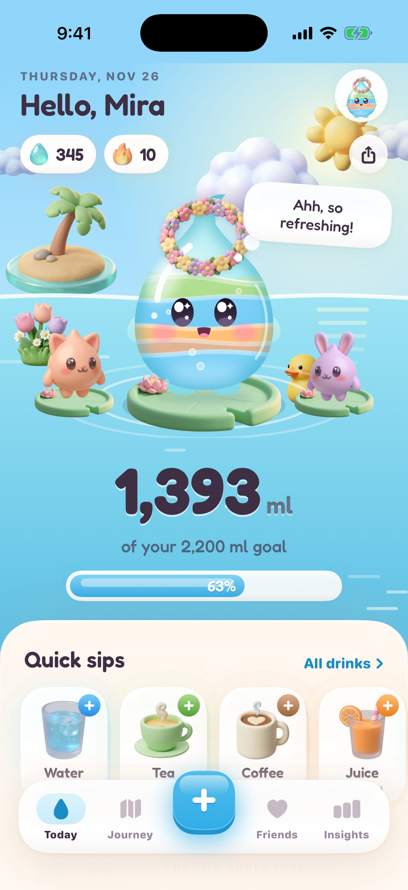
  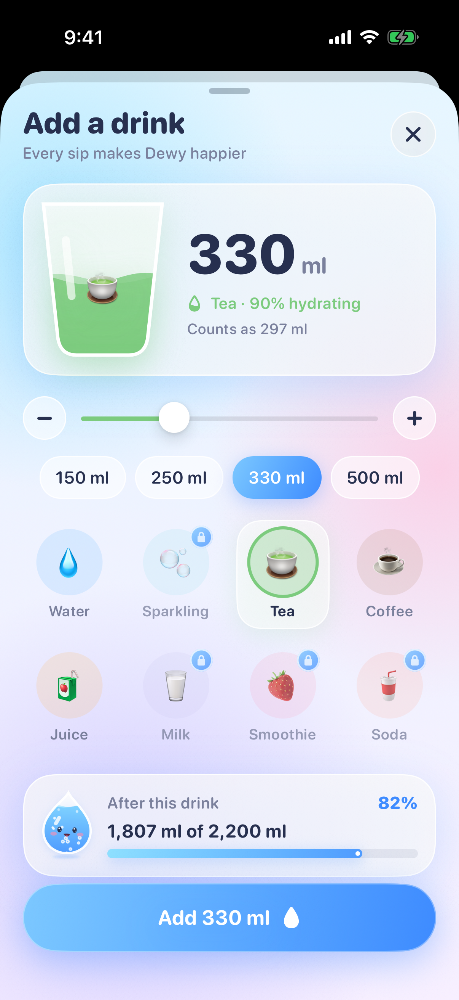
  
</p>
<p align="center">
  
  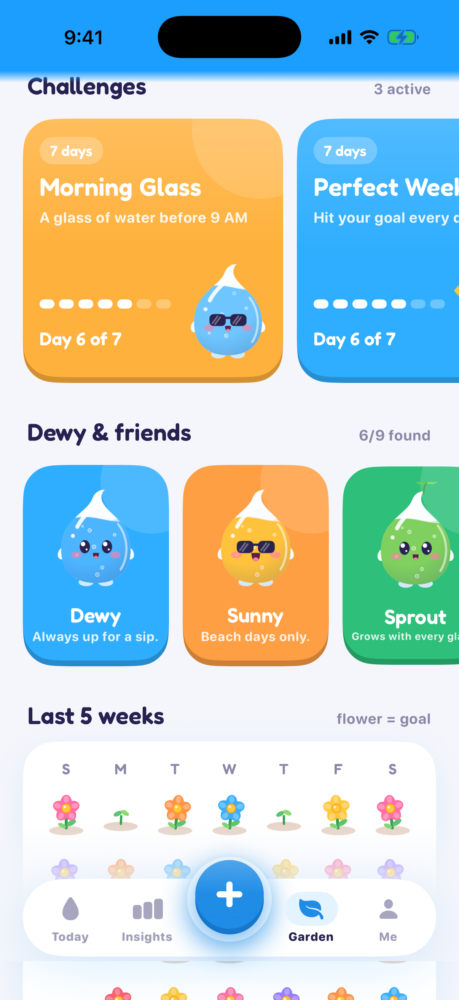
  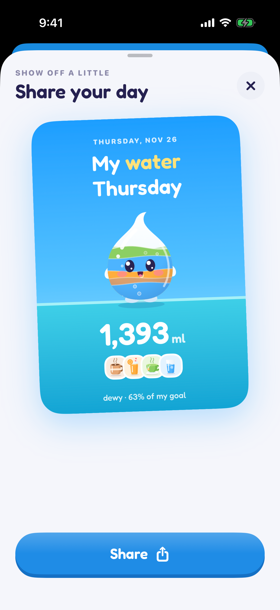
</p>
<p align="center">
  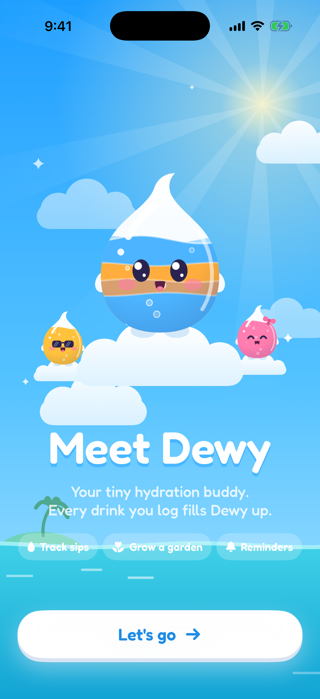
  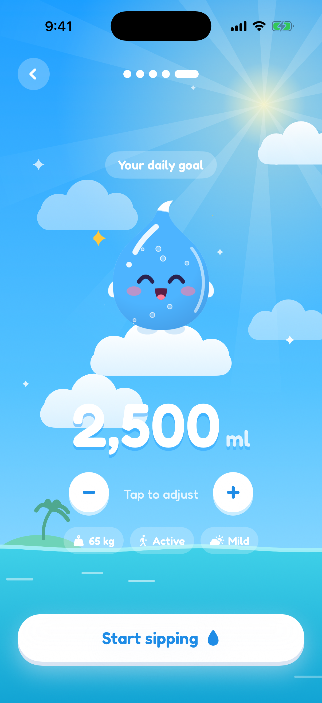
  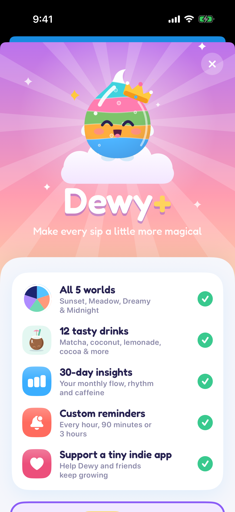
</p>
<p align="center">
  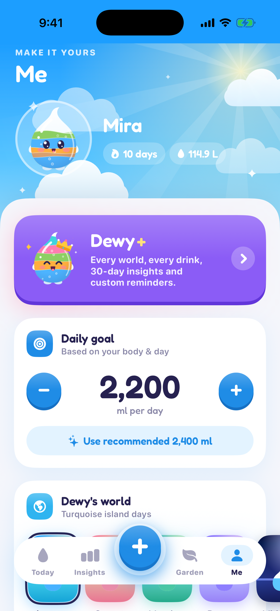
  
  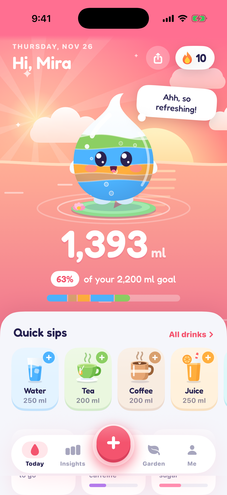
</p>

<details>
<summary><b>More worlds</b> (Midnight · Meadow · Dreamy)</summary>
<p align="center">
  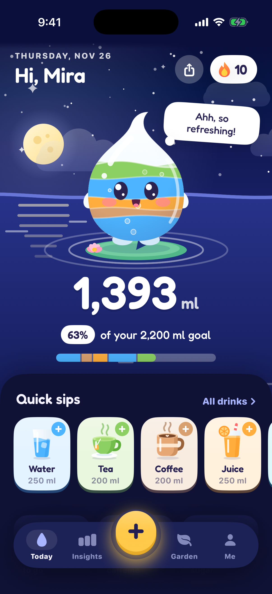
  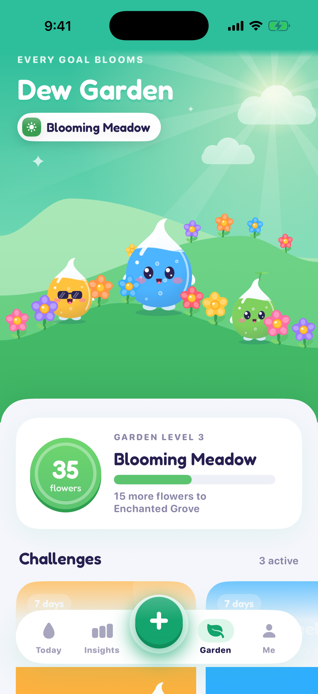
  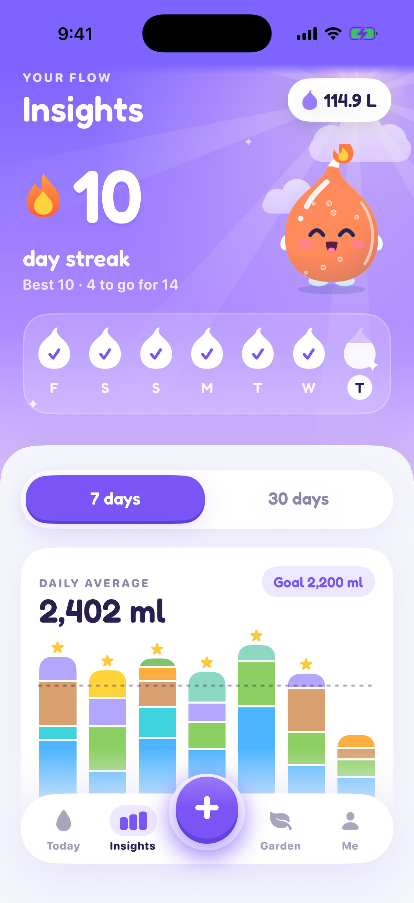
</p>
</details>

> Every screenshot above is a real iOS Simulator capture, taken by CI on each push (`.github/workflows/ios.yml` → `scripts/screenshots.sh`). The GIF comes from the simulator recording in `docs/raw/`. CI simulators have no GPU, so the GIF plays less smoothly than the app does on a real iPhone.

---

## Design language

Dewy is built on one idea: **a tiny world in a drop.** Every screen is a place in the same little world, lit by the same sun, and every element follows the same handful of rules, so the app reads as one designed thing rather than a pile of screens.

| | Rule | In the app |
| --- | --- | --- |
| 🌤 | **Worlds, not themes.** Each theme is a place with its own three-stop sky, sun or moon, horizon water and accent. | Lagoon (island with a palm), Sunset (a sun sinking into the sea), Meadow (hills and a pond), Dreamy (cloud banks), Midnight (moon and stars). The sky also follows the real time of day: dawn, day, dusk and night. |
| 💧 | **One hero.** Dewy is the only character-sized thing on screen and always stands *in* the world: on a lily pad, a cloud, or a hill. | A glassy droplet with a little flick at the tip, stubby arms and feet, and a "parfait" of drink-colored layers inside. |
| 🍬 | **Candy depth.** Anything you can press sits on a darker "lip" and squishes down when tapped, like a gummy key. | Buttons, chips, drink tiles, plan cards, challenge cards and stat tiles all share the same 3D lip. |
| 🎨 | **Illustrated, never emoji.** Drinks, medals, flames and flowers are drawn in one flat style: soft white gloss top-left, deeper tone bottom-right, no outlines. | 12 drink illustrations (glass, mug, can, carton, mason jar, coconut…) and candy medals for badges. |
| 🔤 | **Two voices.** Fredoka for headlines, numbers and buttons; SF Pro Rounded for reading. | Fredoka's round terminals echo Dewy's shape. |
| 🫧 | **Everything is liquid.** Motion uses springs, squash & stretch and ripples. Ambient motion is slow and stops with Reduce Motion. | Waves roll inside Dewy, the lily pad ripples on every sip, clouds drift, Dewy breathes, blinks and waves back when poked. |

**Colors.** Every world defines the same tokens (`sky`, `sea`, `sunGlow`, `accent`, `accentDeep`, `accentSoft`, `canvas`, `card`, `ink`). Each drink has a matched `light / color / deep` family with similar brightness, so the layers inside Dewy stack like a parfait and the dark face always stays readable. Dewy+ has its own violet and gold identity in every world.

**Art pipeline.** Illustrations live as SVG in `design/` and are exported to the asset catalog with `node scripts/export-art.js` (Playwright + Chromium), so the art stays editable and crisp. The mascot, scenes and lily pad are drawn in code with `Canvas` from the same design coordinates.

## Features

- 💧 **Dewy, a living mascot.** Fills with a layer for every drink, with rolling waves and bubbles. Four moods (thirsty → okay → happy → ecstatic), blinking, breathing, a squish when you drink and a wave when you poke it.
- 🌍 **Living worlds.** Five illustrated worlds with drifting clouds, sparkling water and a sky that changes with the time of day.
- ⚡️ **Log from anywhere.** A raised "+" in the tab bar opens the drink sheet from any tab; quick-sip tiles log a drink's usual serving in one tap; undo is one tap away.
- 🍵 **12 drinks** with their own illustrations, hydration factors, caffeine and sugar: water, sparkling, tea, coffee, juice, milk, smoothie, soda, lemonade, hot cocoa, coconut water and matcha.
- ☕️ **Caffeine and sugar tracking.** Today's caffeine and sugar at a glance, a caffeine budget you choose (200/300/400 mg) and a caffeine card in Insights.
- 🏆 **Challenges.** Week-long quests with daily rules: Morning Glass, Perfect Week, Soda Detox, Caffeine Cut, Tea Ritual and Taste Rainbow, each with Dewy dressed for the occasion.
- 🎉 **Goal celebration.** Confetti, a goal chime, haptics and a "Goal smashed!" card when you reach 100%.
- 📈 **Insights.** Your week as seven little Dewy droplets, a streak hero, daily bars stacked by drink color, stat tiles, a month calendar with streak capsules, a "what you drink" donut, caffeine and sip rhythm.
- 🌸 **Dew Garden.** Dewy and the friends you've found hang out in a meadow where a flower grows for every goal day. Garden levels, 9 collectible **Dewy friends** (Sunny, Sprout, Berry, Frosty, Royal…) with drawn outfits, and 9 candy medals.
- 📱 **Widgets.** Home Screen widgets show Dewy filling up in your world's colors; the medium one logs water, tea or coffee with one tap, no app launch needed. Lock Screen widgets show a progress gauge.
- 🗣 **Shortcuts & Siri.** A "Log a drink" action with any drink and amount.
- 📤 **Share your day.** A shareable card with Dewy holding today's drinks, your total and your drink of the day.
- 🔔 **Gentle reminders** between wake-up and bedtime, with rotating cute messages.
- 🔊 **Sound and touch.** Original synthesized bloop, pour and goal sounds (they respect the silent switch) and haptics; both can be turned off.
- 🧭 **Personalized onboarding.** Weight, activity, climate and schedule set your daily goal, revealed with a counting animation.
- ♿️ **Accessible.** VoiceOver labels on the mascot, charts, tiles and slider; Reduce Motion stops ambient animation.
- 🔒 **Private by design.** Everything is stored on the device in a single JSON file. Saved data from older versions keeps loading.

## Monetization (Dewy+)

StoreKit 2, implemented in `PurchaseManager.swift`:

| Product ID | Type | Price |
| --- | --- | --- |
| `dewy.plus.yearly` | Auto-renewable, 3-day free trial | $19.99 / year |
| `dewy.plus.monthly` | Auto-renewable | $2.99 / month |
| `dewy.plus.lifetime` | Non-consumable | $39.99 |

**Free:** core tracking, the Lagoon world, water/tea/coffee/juice, 7-day insights, challenges, garden and badges.
**Dewy+:** 4 more worlds, 8 more drinks, 30-day insights and custom reminder intervals.

`Dewy.storekit` is wired into the shared scheme, so purchases work in the simulator with no App Store Connect setup.

## Why this app?

**People already pay for this.** Water tracking is one of the most searched-for habits in Health & Fitness, and the *cute* version of it sells well:

| App | Angle | Third-party revenue estimate |
| --- | --- | --- |
| Waterllama | Cute characters + water tracking | ~$90K–160K / month (estimates vary, some much higher) |
| Finch | Cute pet that grows as you build habits | ~$1M / month |

Those numbers come from analytics sites (Screensdesign, Adapty, AppGoblin), so treat them as rough. What they show is that a **cute mascot plus a simple daily habit** keeps people coming back and paying.

**Why $1K/month is realistic.** At $19.99/year, that's about **50–60 new yearly subscribers a month**. With a typical 2–4% download-to-paid conversion, that takes roughly **1,500–3,000 downloads a month** (≈50–100 a day). A well-made niche app with good App Store optimization (ASO) can reach that.

## Project structure

```
Dewy/
├── App/DewyApp.swift            # entry point, router, floating tab bar with the add button
├── Design/                      # world tokens, Fredoka type, candy buttons, cards, chips, haptics, sounds
├── Components/                  # MascotView (Dewy), Scene (worlds, lily pad), shapes, confetti, flowers
├── Models/Models.swift          # drinks, profile, challenges, achievements, Dewy friends, tips
├── Store/                       # HydrationStore (state + stats), StoreKit, reminders, demo data
├── Features/                    # Today, Drink sheet, Insights, Garden, Me, Paywall, Onboarding, Share card
├── Widgets/                     # widget views and the "Log a drink" App Intent (shared with the extension)
└── Resources/                   # Fredoka fonts (OFL) and synthesized sound effects
DewyWidget/                      # WidgetKit extension (Home and Lock Screen widgets)
Config/                          # entitlements (App Group shared by the app and the widget)
design/                          # SVG sources for the drink illustrations and the app icon
scripts/export-art.js            # exports the SVGs into the asset catalog
scripts/screenshots.sh           # builds and captures simulator screenshots
```

## Build & run

1. Open `Dewy.xcodeproj` in **Xcode 16 or later**.
2. Choose your team under *Signing & Capabilities* for both targets and change the bundle IDs (`com.dewyapp.Dewy`, `com.dewyapp.Dewy.Widget`) and the App Group (`group.com.dewyapp.Dewy`, used in `Config/*.entitlements` and `Persistence.appGroup`).
3. Run on an iPhone or simulator running iOS 17+.

**Demo mode.** Launch with `-screenshot today|add|insights|garden|challenges|share|settings|widgets|paywall|onboarding|celebrate` to load sample data. Optional flags: `-theme peach|matcha|lavender|midnight`, `-premium YES`, `-step 0…5`. Run `bash scripts/screenshots.sh` to regenerate every screenshot.

**Art.** Edit the SVGs in `design/`, then run `node scripts/export-art.js` to refresh the asset catalog.

## Shipping checklist

- [ ] Set your bundle ID and team, and create the 3 products above in App Store Connect.
- [ ] Replace the Terms and Privacy links in `PaywallView.swift` with your own.
- [ ] App Store title idea: **"Dewy: Cute Water Tracker"**. Subtitle: *"Drink reminder & hydration pet"*.
- [ ] Keywords: `water,reminder,hydration,drink,tracker,intake,habit,cute,pet,daily,goal,log`.
- [ ] Post short TikTok/Reels clips of Dewy celebrating. Cute mascots spread well on short-video apps.

## Roadmap ideas

- Apple Health water sync
- Live Activity and Apple Watch quick-log
- A wardrobe so you can dress Dewy in the outfits your friends wear

## Credits

Display type: [Fredoka](https://github.com/google/fonts/tree/main/ofl/fredoka) by Milena Brandão, SIL Open Font License (see `design/Fredoka-OFL.txt`). All illustrations, the mascot and sounds are original to this project.
