<div align="center">


# Dewy — cute water tracker

**A tiny droplet buddy who fills up, layer by colorful layer, with every sip.**
Log drinks, watch Dewy fill with the colors of what you drank, keep your streak, collect Dewy's friends, and grow a garden that blooms every day you hit your goal.

SwiftUI · iOS 17+ · Swift Charts · StoreKit 2 · no third-party dependencies

[](https://github.com/mirzotipi-wq/APP2/actions/workflows/ios.yml)

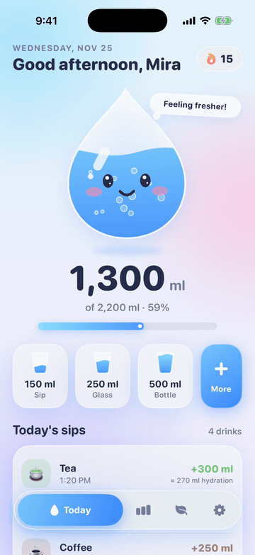

</div>

---

## Screenshots

<p align="center">
  
  
  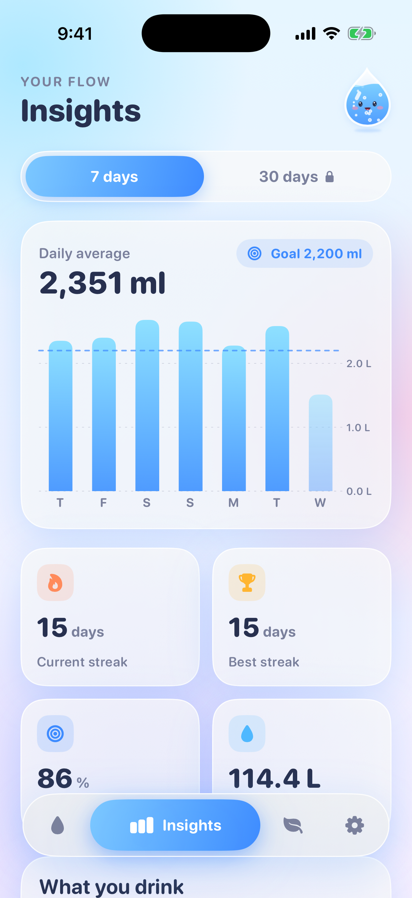
</p>
<p align="center">
  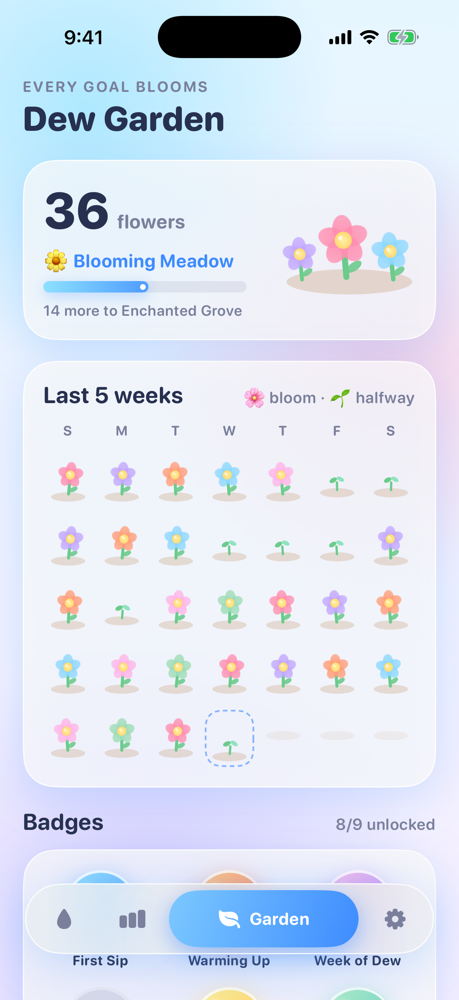
  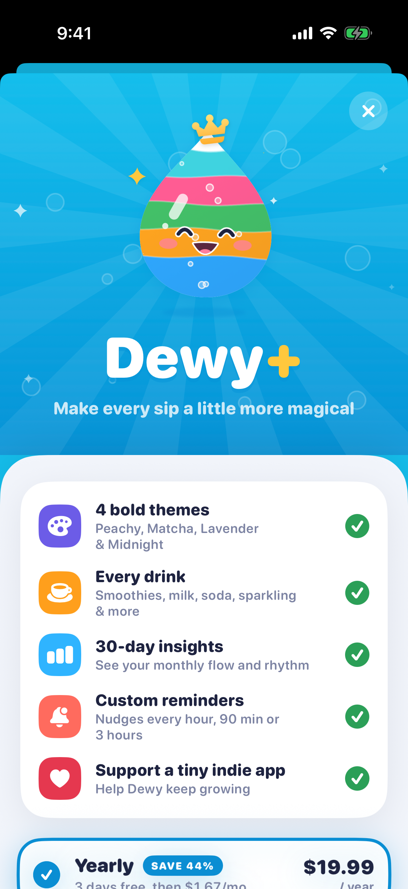
  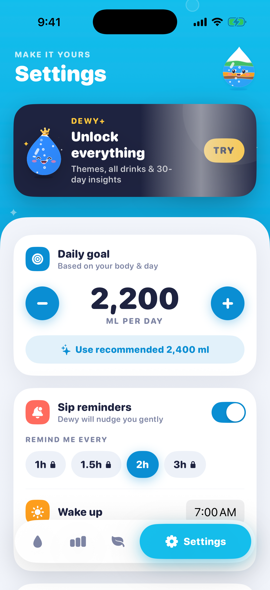
</p>
<p align="center">
  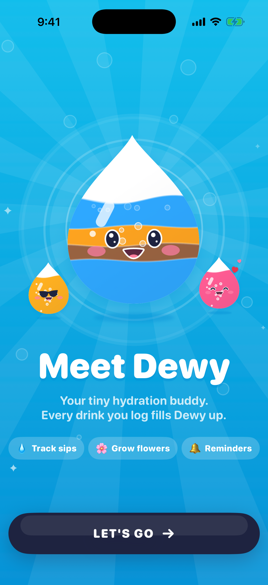
  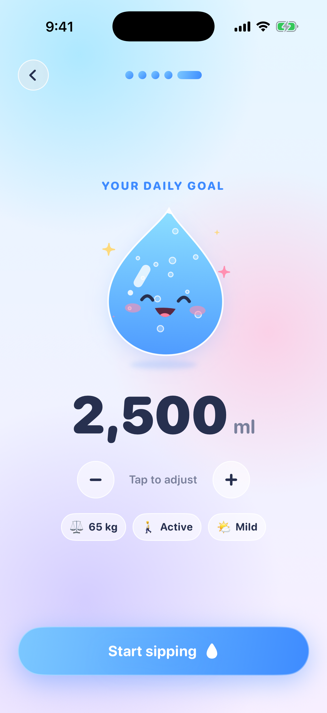
  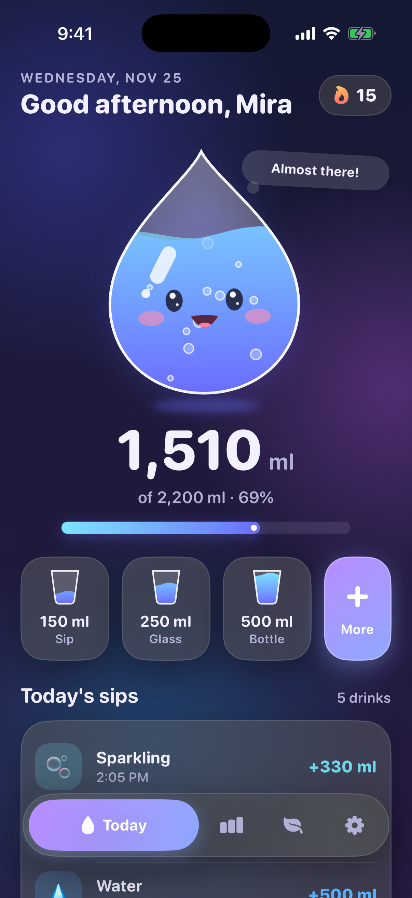
</p>

<details>
<summary><b>More themes</b> (Peachy · Matcha · Lavender)</summary>
<p align="center">
  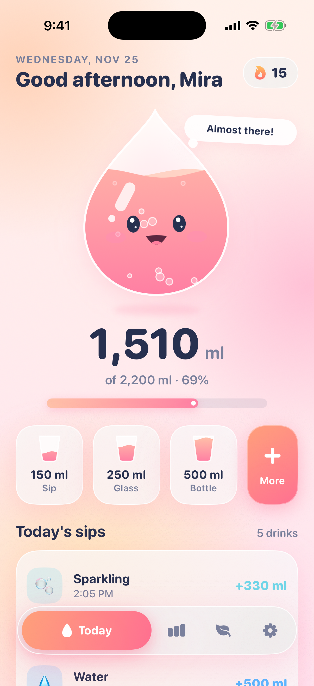
  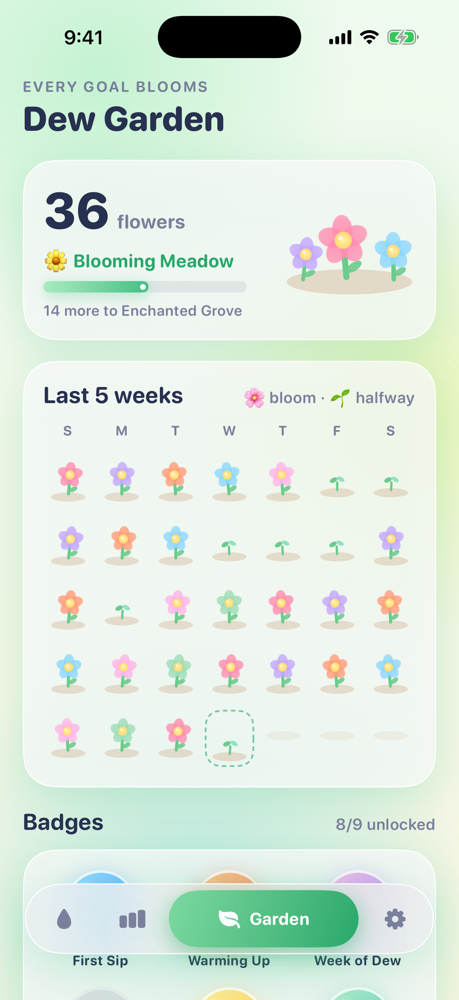
  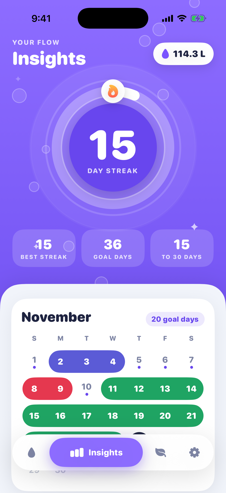
</p>
</details>

> Every screenshot above is a real iOS Simulator capture, taken by CI on each push (`.github/workflows/ios.yml` → `scripts/screenshots.sh`). The GIF comes from the simulator recording in `docs/raw/`. CI simulators have no GPU, so the GIF plays less smoothly than the app does on a real iPhone.

---

## Why this app?

**People already pay for this.** Water tracking is one of the most searched-for habits in Health & Fitness, and the *cute* version of it sells well:

| App | Angle | Third-party revenue estimate |
| --- | --- | --- |
| Waterllama | Cute characters + water tracking | ~$90K–160K / month (estimates vary, some much higher) |
| Finch | Cute pet that grows as you build habits | ~$1M / month |

Those numbers come from analytics sites (Screensdesign, Adapty, AppGoblin), so treat them as rough. What they show is that a **cute mascot plus a simple daily habit** keeps people coming back and paying.

**Why $1K/month is realistic.** The goal is ~$1K/month, not millions. At $19.99/year, that's about **50–60 new yearly subscribers a month**. With a typical 2–4% download-to-paid conversion, that takes roughly **1,500–3,000 downloads a month** (≈50–100 a day). A well-made niche app with good App Store optimization (ASO) can reach that.

**Why it's easy to build.** One screen does most of the work, all data stays on the device (no backend, no accounts), and the code is about 6K lines of SwiftUI.

## Design

The look follows the playbook of the best-loved character habit apps (Waterllama is the main reference): **bold flat color, a character that fills up, chunky rounded type, and big friendly buttons.**

- **Color worlds, not pastel haze.** Every screen opens on a saturated hero color (turquoise Lagoon, coral Peachy, green Matcha, purple Lavender or deep-navy Midnight) and content sits on solid white cards.
- **Dewy fills with what you drink.** Every drink you log pours a new layer into Dewy in that drink's color, with rolling waves and rising bubbles, so your day reads at a glance.
- **Flat, colorful cups.** Water and sparkling come in glasses, tea and coffee in mugs, juice, smoothies and soda in tumblers with straws.
- **Chunky type and dark pill buttons.** SF Rounded in heavy and black weights, all-caps labels, and navy capsule buttons that read like stickers.
- **Motion everywhere.** Halo ripples behind Dewy, drifting bubbles and twinkles, a turning sunburst on the paywall, swaying flowers and confetti when you hit your goal.

## Features

- 💧 **Dewy, a living mascot.** A droplet that fills with a layer for every drink, with waves, bubbles, blinking eyes and four moods (thirsty → okay → happy → ecstatic). It squishes when you drink and wobbles when you poke it.
- ⚡️ **One-tap logging.** A quick-add row of drink cups logs each drink's usual serving. The drink sheet takes on the drink's color and has a live cup, slider and presets.
- 🍵 **8 drinks with hydration factors.** Coffee counts as 80%, soda as 60%, and so on.
- 🎉 **Goal celebration.** A burst of confetti, hearts, droplets and sparkles with haptics when you hit 100%.
- 📈 **Insights.** A streak ring, a month calendar where goal streaks join into bold colored capsules, daily bars stacked by drink color, stat tiles, a "what you drink" donut and an hourly sip rhythm.
- 🌸 **Dew Garden.** An illustrated landscape under your theme's sky (a moon and stars in Midnight) where a flower grows for every goal day. Garden levels, 9 collectible **Dewy friends** (Sunny, Sprout, Berry, Frosty, Royal…) and 9 badges.
- 🔔 **Gentle reminders.** Local notifications between wake-up and bedtime, with rotating cute messages.
- 🎨 **5 themes.** Lagoon (free), plus Peachy, Matcha, Lavender and a dark Midnight theme.
- 🧭 **Personalized onboarding.** Weight, activity, climate and schedule set your daily goal, revealed with a counting animation.
- 🔒 **Private by design.** Everything is stored on the device in a single JSON file.

## Monetization (Dewy+)

StoreKit 2, implemented in `PurchaseManager.swift`:

| Product ID | Type | Price |
| --- | --- | --- |
| `dewy.plus.yearly` | Auto-renewable, 3-day free trial | $19.99 / year |
| `dewy.plus.monthly` | Auto-renewable | $2.99 / month |
| `dewy.plus.lifetime` | Non-consumable | $39.99 |

**Free:** core tracking, Lagoon theme, water/tea/coffee/juice, 7-day insights, garden and badges.
**Dewy+:** 4 premium themes, sparkling/milk/smoothie/soda, 30-day insights, and custom reminder intervals.

`Dewy.storekit` is wired into the shared scheme, so purchases work in the simulator with no App Store Connect setup.

## Project structure

```
Dewy/
├── App/DewyApp.swift            # entry point, root routing, floating tab bar
├── Design/                      # color worlds, typography, cards, pill buttons, chips, haptics
├── Components/                  # MascotView (Dewy + layered liquid), shapes, drink cups, hero backdrop, garden landscape, confetti
├── Models/Models.swift          # drinks, profile, achievements, Dewy friends, tips
├── Store/                       # HydrationStore (state + stats), StoreKit, reminders, demo data
└── Features/                    # Today, Drink picker, Insights, Garden, Settings, Paywall, Onboarding
Dewy.xcodeproj                   # Xcode 16 project (folder-synced; new files are picked up automatically)
Dewy.storekit                    # local StoreKit testing config
scripts/screenshots.sh           # builds and captures simulator screenshots
```

## Build & run

1. Open `Dewy.xcodeproj` in **Xcode 16 or later**.
2. Choose your team under *Signing & Capabilities* and change the bundle ID (`com.dewyapp.Dewy`).
3. Run on an iPhone or simulator running iOS 17+.

**Demo mode.** Launch with `-screenshot today|add|insights|garden|settings|paywall|onboarding|celebrate` to load sample data. Optional flags: `-theme peach`, `-premium YES`, `-step 0…5`. Run `bash scripts/screenshots.sh` to regenerate every screenshot.

## Shipping checklist

- [ ] Set your bundle ID and team, and create the 3 products above in App Store Connect.
- [ ] Replace the Terms and Privacy links in `PaywallView.swift` with your own.
- [ ] App Store title idea: **"Dewy: Cute Water Tracker"**. Subtitle: *"Drink reminder & hydration pet"*.
- [ ] Keywords: `water,reminder,hydration,drink,tracker,intake,habit,cute,pet,daily,goal,log`.
- [ ] Post short TikTok/Reels clips of Dewy celebrating. Cute mascots spread well on short-video apps.

## Roadmap ideas

- Home and Lock Screen widgets (most-requested feature for water apps)
- Apple Health water sync
- Live Activity and Apple Watch quick-log
- More mascot outfits as rewards
